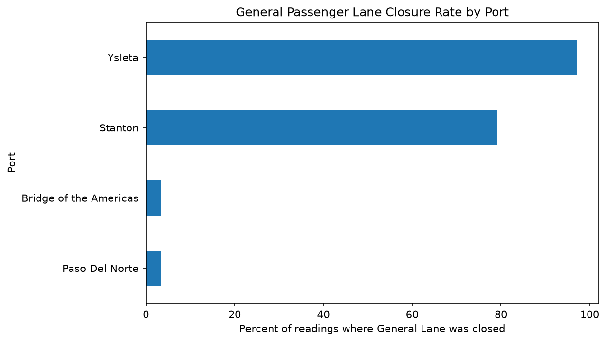
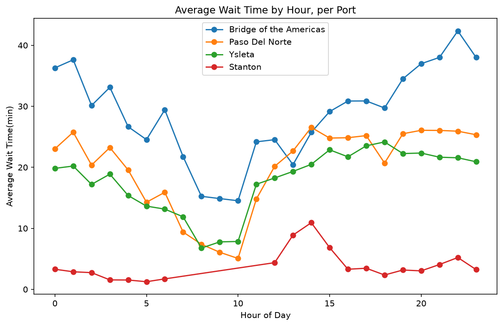
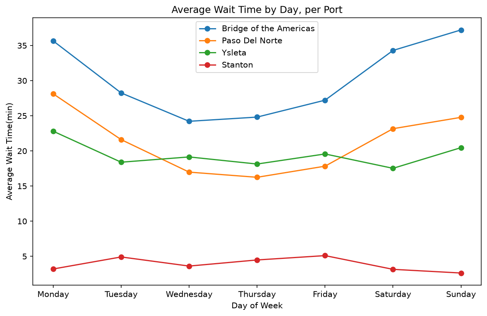

# Border Wait Time Analysis

An automated pipeline that collects live U.S. Customs and Border Protection (CBP)
wait-time data for El Paso's four ports of entry, plus a model that predicts
wait times from port, lane, hour, and day of week.

## What this is

This repo scrapes CBP's live wait-time feeds on an hourly schedule through GitHub
Actions, accumulates a growing dataset with no manual work, and analyzes crossing
times across El Paso's bridges. GitHub's scheduler is best-effort, so actual
collection is irregular (see Data quality notes).

## Data source

Live RSS feeds from [bwt.cbp.gov](https://bwt.cbp.gov), covering:
- Bridge of the Americas (BOTA)
- Paso Del Norte (PDN)
- Ysleta
- Stanton DCL

Each run records Commercial, Passenger, and Pedestrian lane categories, including
General, Fast, Sentri, and Ready lane types. Results below use a frozen snapshot,
`data/raw/snapshots/wait_times_snapshot 11-2-26.csv` (Aug 9 to Nov 2, 2026), so they
can be reproduced even though the live file keeps growing.

## Findings

Based on the 8,860 readings with a numeric wait time in the Nov 2 snapshot.

- **Fastest bridge:** Stanton, about 3.8 minutes on average.
- **Slowest bridge:** Bridge of the Americas, about 30.4 minutes, roughly 8x
  Stanton.
- **Caveat on those averages:** they mix every lane type together. Stanton and
  Ysleta's General passenger lanes are mostly closed, so those averages leave out
  the longest-waiting lane. Compare lanes directly before concluding one bridge is
  "faster."
- **General passenger lane closures:** the General lane was closed in 97.2% of
  Ysleta readings and 79.1% of Stanton readings, versus 3.4% at Bridge of the
  Americas and 3.3% at Paso Del Norte (702 readings per port). Possible
  explanations include these ports routing general traffic through alternate
  procedures not reflected in CBP's standard categories. This is worth
  investigating further.
- **Hour-of-day pattern:** Bridge of the Americas is consistently the slowest
  crossing and Stanton the fastest. Paso Del Norte and Ysleta cross paths around
  midday.
- **Day-of-week pattern:** similar shape to the hourly pattern, with Ysleta and
  Paso Del Norte sometimes crossing during the week.

## Data quality notes

- **Collection is irregular.** The workflow is scheduled hourly, but GitHub's cron
  is best-effort and often runs late or skips runs. The Nov 2 snapshot has 702
  collection runs over about 85 days (about 8 per day). The median gap between
  runs is 2.2 hours, 285 gaps are longer than 3 hours, and the longest gap is 12.4
  hours.
- Hours 2-5 and 12 have fewer readings across all ports due to an early scraper
  bug (handling of CBP's "Pending" status), fixed August 15. Treat these hours as
  lower-confidence.
- Numeric readings are uneven across ports because closed and not-applicable lanes
  have no wait value. Only 8,860 of 19,656 rows are numeric.

## How it works

- `scraper/collect.py` fetches and parses the CBP feeds, handling four distinct
  data states (numeric readings, closed lanes, not-applicable lane types, and
  pending updates).
- `.github/workflows/scrape.yml` runs the scraper on an hourly schedule via GitHub
  Actions and commits new data automatically.
- `notebooks/exploratory_analysis.ipynb` is the analysis behind the findings above.
- `notebooks/model.ipynb` is the prediction model.
- `data/raw/wait_times.csv` is the accumulating dataset, and `data/raw/snapshots/`
  holds frozen copies used for modeling.

  

# Border Wait Time Predictions

Predicts the wait time in minutes for a given port, lane category, lane type, hour
of day, and day of week.

## Data

- Snapshot: `wait_times_snapshot 11-2-26.csv`, Aug 9 to Nov 2, 2026.
- Only rows with a numeric wait time were used: 8,860 of 19,656 rows. Closed,
  not-applicable, and pending rows have no wait value and were excluded.
- Features: port, category, lane type, and hour and day of week. Hour and day of
  week are encoded as sine/cosine pairs on a 24-hour and a 7-day cycle, so hours
  like 23:00 and 0:00, or Sunday and Monday, are treated as neighbors.

## Tests

- The data was split 80/20 by time: the model trains on the earliest 80% (7,091 rows,
  Aug 9 to Oct 4) and is scored on the latest 20% (1,769 rows, Oct 4 to Nov 2).
  Splitting by time means the model never sees the period it is graded on, which
  mimics real use, where it must predict the future from the past.
- Score: mean absolute error (MAE), the average miss in minutes.

## Results

| Method | MAE (minutes) | Rows scored |
|--------|---------------|-------------|
| Training median for every row | 19.87 | 1,769 |
| Port/hour lookup | 20.00 | 1,769 |
| Linear Regression | 11.29 | 1,769 |
| Port, category, lane type, and hour lookup | 9.52 | 1,767 |
| Random Forest | 8.30 | 1,769 |

Two test rows had no matching group in the training data, so they are left out of
the port, category, lane type, and hour lookup only. The effect on its score is
negligible.

Error split by lane. General passenger lanes are the longest waits (average 50.9
minutes in the test window, 258 rows); all other lanes average 17.6 minutes (1,511
rows).

| Method | General passenger lanes MAE | All other lanes MAE |
|--------|-----------------------------|---------------------|
| Training median for every row | 42.95 | 15.93 |
| Linear Regression | 19.46 | 9.89 |
| Port, category, lane type, and hour lookup | 16.96 | not computed |
| Random Forest | 13.79 | 7.36 |

## Takeaways

- Random Forest cut error about 58% below the median guess (19.87 to 8.30).
- A lookup by port and hour did no better than a flat median guess (20.00 vs
  19.87). Lane type matters: it separates lanes that average about 3 minutes
  (Sentri) from lanes that average about 50 (General passenger).
- The gap between Random Forest and the best simple lookup is small overall (8.30
  vs 9.52) but wider on General passenger lanes (13.79 vs 16.96). The model helps
  most where waits are longest.
- Random Forest is still off by about 14 minutes on General passenger lanes, where
  the average wait is about 51. The single overall MAE understates how hard those
  lanes are to predict.
- Random Forest overfits. Its training error is 5.64 versus 8.30 on test data, so
  test error is about 47% higher. No tuning has been done yet.

## Limitations

- About 12 weeks of data (85 days), with irregular gaps in collection.
- The test window is only the most recent 4 weeks, so results say nothing about
  holidays or other seasons.
- One train/test split, so there is no measure of how stable the scores are.
- No hyperparameter tuning.
- The General passenger lane split covers only 258 test rows, so those numbers are
  noisier than the overall ones.

## Next Steps

- Report error per port, and per lane type beyond the General passenger split.
- Limit tree depth and use `TimeSeriesSplit` cross-validation to check how much the
  scores can be trusted.
- Add lag features (the previous reading) and compare against a "same as last
  reading" baseline.
- Move collection to an external trigger for steadier cadence.